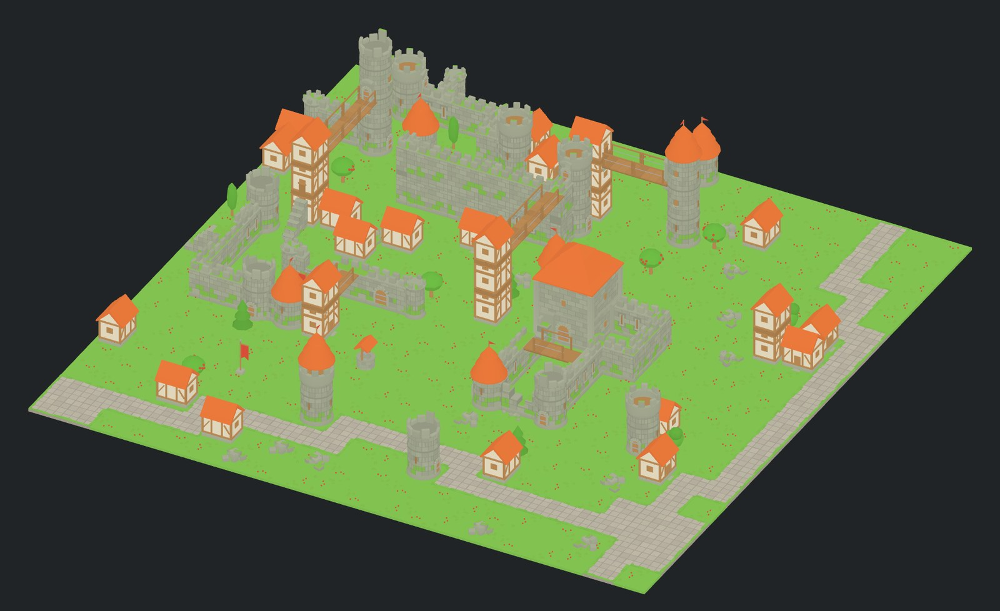
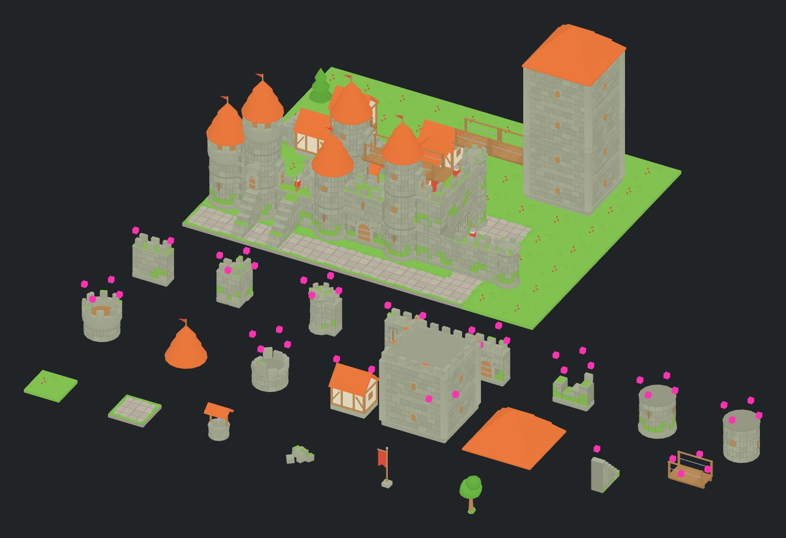
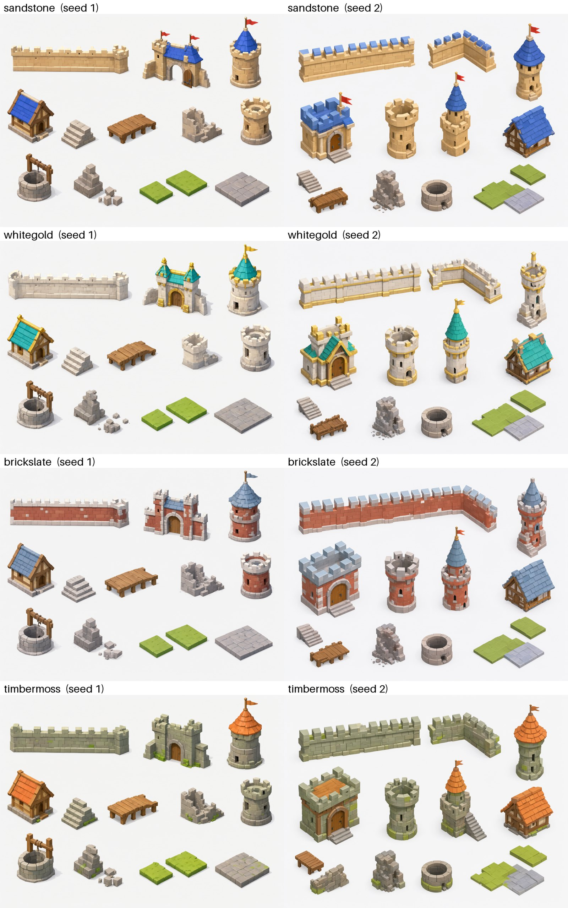

# Modular fantasy castle kit

Low-poly timber-and-mossy-stone castle pieces that snap together on a 2 m cubic grid, made procedurally in Blender.
Each piece carries typed sockets on its faces, so the same rules drive placing pieces by hand and generating whole
villages by wave function collapse, and optional join parts make neighbours blend: a tower grows a shoulder where a
wall meets it, a house on a house becomes one two-storey house, a bridge reaches the door it arrives at.

Nothing in `export/` is tied to an engine: GLB meshes, a JSON catalog with the sockets, and JSON colour themes.

*A village generated from the sockets alone (rendered in Unity).*

| Category | Pieces | Triangles (base + join parts) | What is in it |
|---|---|---|---|
| walls | 6 | 3,048 + 6,248 | straight, junction (a corner, T, cross or end, as its neighbours say), round-turret end (also a buttress on a wall's flank), window, gate (a gatehouse between towers), broken |
| towers | 5 | 3,076 + 7,216 | base, storey, crenellated top, cone roof, broken top; shoulders, links and doors |
| buildings | 5 | 2,336 + 9,384 | timber house (storeys, long houses), 2x2x2 keep (a crenellated square tower that stacks), keep roof, stairs, bridge segment |
| ground | 2 | 148 + 384 | grass and path tiles (grassy path edges) |
| props | 4 | 1,004 + 722 | well, rubble, banner, tree (oak, pine, poplar or apple, picked per cell) |

*Every piece on its own, and a test castle showing the joins. Pink cubes mark the side faces that join.*

## Colour

Pieces carry a vertex-colour mask, not colours. In the `Col` attribute, red, green and blue pick tint areas A, B and
C, and alpha 0 picks area D; a mask dimmer than 1 darkens that face (stone blocks vary by a shade). Each piece names
four roles for its areas (`roles` in the catalog), and `themes.json` maps roles to colours:
**timbermoss** (the default: grey-green stone, oak, orange clay roofs), sandstone, whitegold and brickslate. Shade
with `albedo = R·A + G·B + B·C + (1 − alpha)·D`. No theme colour is near-black, because the kit was made for an
additive see-through display, where dark reads as transparent.

## Grid and sockets

- A cell is 2 m wide, deep and tall. A piece's origin is the bottom centre of its first cell; trim may rise up to
  0.45 m into the cell above. Ground tiles sit under the first level, 6 cm proud of the board.
- `catalog.json` is in glTF axes (+Y up, front +Z). Each piece lists its `cells` and, per cell, a socket for each
  face (`n e s w u d`); a missing face is open. Some glTF importers (glTFast in Unity) mirror X: convert the cells
  and swap the `e` and `w` faces once when you load the catalog.
- Two touching faces fit if either socket lists the other in `fits`. `open` meets any socket whose `air` is true.
  A piece is supported if one of its non-open bottom faces fits the top face below it. An `aligned` bottom (walls,
  houses, keeps) stacked on a piece must show the same sides as it, so a wall never sits crosswise on a wall.
- `air` only matters to a generator: placing by hand never checks empty neighbours. A wall's ends (`wall_edge`)
  don't allow air, so generated walls always run into a wall, a tower or the round-turret end.
- A bridge is a one-cell walkway at wall-walk height. Its ends (`bridge_link`, which `carries`: a joined end holds
  it up) meet another segment or the side of a tower, wall, keep or house, so spans of any length hang between
  buildings. Stairs lean on the same sides (`stairs_top`). Ruins (`ruin_side`) and crenellated tops
  (`parapet_side`) take neither.
- Both `land` at wall-walk height, so the face they meet says what must stand over it (`above`): a storey with a door
  (towers, houses) or nothing (a wall's open walk). A generator applies it once both cells are decided; it is what
  keeps bridges off roofs.
- Each piece has `gen` hints for a generator: a weight, the levels it may stand on, and tags (`scatter`: turn it at random
  wherever it lands). A piece whose look adapts to its neighbours lists fixed shapes for a generator in `gen_faces`
  (the junction: corner, T, cross) while its `faces` stay permissive for building by hand.
- `align_as`: a side that counts as another when stacking is checked (a gate's face as a wall's flank, so a wall stands
  on a gate). `aliases`: old piece ids and what replaced them, for saves.

## Join parts

`parts` in a catalog entry lists optional meshes, exported as `<id>__<part>`, each shown when all of its conditions
hold for one of the piece's cells. A condition reads the neighbour across a face, in piece space:

| Condition | Holds when |
|---|---|
| `e:wall_edge` | the neighbour to the east shows us a wall's end |
| `n-:wall_edge\|stairs_top` | the neighbour north and one level down shows either socket |
| `u:!house_base` | no storey stands on this one |
| `n:!#path` | the neighbour north isn't a path tile (`#` tests tags) |
| `u:empty` | nothing is above |
| `~2/4` | a pick fixed by the cell's position: one cell in four (a tree's species) |

Merge the base mesh with the parts that hold and draw it as one mesh; a piece only needs re-checking when a
neighbour changes. The parts give:

- towers: a shoulder where a wall meets them, a link to a tower or keep beside them, a door onto a wall walk, stair or
  bridge;
- walls: no merlons or plinth where a wall stands on a wall, so a stack reads as one taller wall; no merlons where a
  stair or bridge lands; the junction's arms toward each joining neighbour; a turret's stub reaching a wall's flank;
- a gatehouse over a gate between two towers;
- houses: a footing or a jetty, the roof or the walls carried up to the next storey, one roof across houses gable
  to gable, doors where a stair or bridge arrives;
- keeps: a parapet while nothing stands on them, doorways where a stair or bridge arrives, and an abutment where a wall,
  turret or tower meets a side;
- stairs and bridges: a landing or corbelled deck that reaches whatever they meet;
- path tiles: grassy edges where no path continues;
- trees: one of four species.

## Building it

Needs [Blender](https://www.blender.org/) 5.2.

- `build.bat` (or `blender -b --python blender/make.py`) builds every piece into `export/*.glb` and
  `export/catalog.json`. It checks that every theme colours every role and that no colour is too dark.
  Set `BLENDER` to use a blender.exe other than the default install.
- `sync.bat "<project>\Assets\Castle\Kit"` copies `export/` into a game project. Or put that folder in
  `sync_target.txt` (git-ignored) and run `sync.bat` on its own.
- `blender/castle_grid.py` holds the sizes and socket rules, `blender/pieces.py` the pieces, `blender/kit.py` the
  shape helpers.
- Edit `export/themes.json` by hand; the build doesn't regenerate it.

## Concept art

The look came from four style directions generated locally with ComfyUI and Qwen Image 2.1. Timber and mossy stone
was picked, then each piece got a reference image in that style to model from. `concepts.py` makes both (see its
docstring), and `docs/prompts.md` keeps the prompts. The individual images aren't in this repo.

## Where it's used

The kit was built for a hand-tracked castle-building sandbox on XREAL AURA glasses (Unity). That project isn't
part of this repo.

## License

- Assets (everything in `export/` and the images in `docs/`): [CC0 1.0](LICENSE-ASSETS). Use them for anything,
  no credit needed.
- Code (`blender/`, `concepts.py`, the `.bat` scripts): [MIT](LICENSE).
